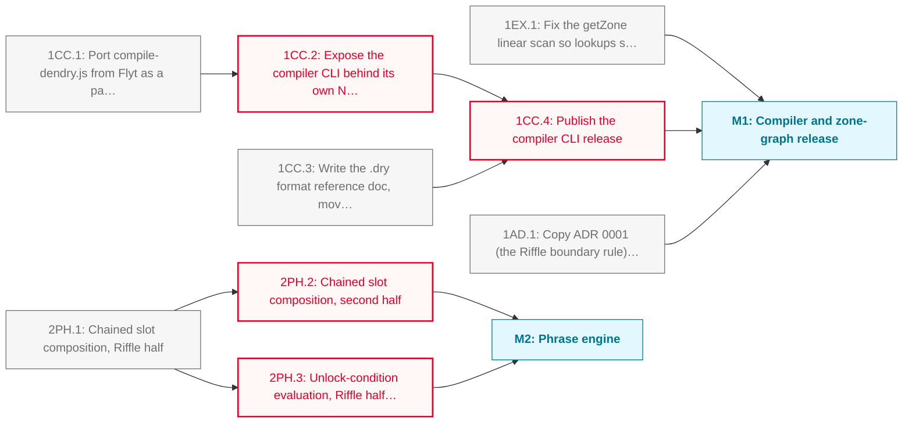

# Riffle PHASE_1 Roadmap

Riffle's first roadmap of its own. The extraction from Flyt is finished (engine code moved, auto-sync removed, 1.0.0 and 1.1.0 published), so this phase carries what is left: the Dendry compiler moving into the package as a CLI, and the Riffle halves of the phrase engine once Flyt's design draws the line.

**Critical path:** `1CC.1 → 1CC.2 → 1CC.4`; the compiler port gates the Node-only export path, and both gate the release Flyt switches its build script to.

---

## Milestone 1: Compiler and zone-graph release

**Goal:** Ship the Dendry compiler from Riffle and settle the zone-graph helpers that 1.1.0 released

- [ ] **1EX.1**: Fix the getZone linear scan so lookups stop walking the whole zone map on every call
  - Note: Issue riffle#5. The code landed with riffle#4 (merged 2026-10-15, released as 1.1.0), so nothing blocks this
- [ ] **1CC.1**: Port compile-dendry.js from Flyt as a parameterised CLI with its tests: the title fallback, the input and output roots and the one-subgame-per-subdirectory convention become parameters
  - Note: Was Flyt 10IC.5. Flyt's docs/adr/0002-compiler-home.md (Flyt PR #30) is the brief. Acceptance includes the engine vocabulary guard covering the compiler, so the CLI must live under the guard's path filter (currently src/lib/) or the filter must widen with it
- [ ] **1CC.2**: Expose the compiler CLI behind its own Node-only export path so browser bundles never see fs imports _(blocked: depends on 1CC.1)_
  - Note: Review note carried from Flyt PR #30
- [ ] **1CC.3**: Write the .dry format reference doc, moved from Flyt's docs/dendrynexus-reference.md
  - Note: Describes the compiler's input format, so it moves with the compiler. Also resolves the doc-comment references Flyt 8EX.5 removed for want of a Riffle equivalent
- [ ] **1CC.4**: Publish the compiler CLI release _(blocked: depends on 1CC.2, 1CC.3)_
  - Note: Flyt then bumps the dependency, switches its compile:dendry script to the CLI and retires scripts/compile-dendry.js (Flyt-side tasks)
- [ ] **1AD.1**: Copy ADR 0001 (the Riffle boundary rule) and ADR 0002 (the compiler's home) from Flyt's docs/adr/ into Riffle's docs/adr/
  - Note: Both govern this repo but live only in Flyt. Flyt keeps ADR 0001 as the decision record of origin with a pointer here

---

## Milestone 2: Phrase engine

**Goal:** Build the Riffle halves of the phrase engine once Flyt's design draws the engine/game line

- [ ] **2PH.1**: Chained slot composition, Riffle half
  - Note: Placeholder. Flyt's ADR 0001 places chained, non-reversible slot composition (Flyt 2PE.1 and 2PE.2) in Riffle. Flyt's 2PE.1 (design the phrase-chain data model) draws the engine/Flyt line and is itself blocked by Flyt 1ES.1 (entity state schema): an external dependency, recorded here rather than wired. Flyt's 2PE.x IDs name different tasks from these
- [ ] **2PH.2**: Chained slot composition, second half _(blocked: depends on 2PH.1)_
  - Note: Placeholder; scope settles when 2PH.1 lands
- [ ] **2PH.3**: Unlock-condition evaluation, Riffle half: the engine evaluates, Flyt authors _(blocked: depends on 2PH.1)_
  - Note: Placeholder. Flyt's ADR 0001 splits unlock-condition resolution (Flyt 2PE.3) across both repos

---

## Dependency Diagram

